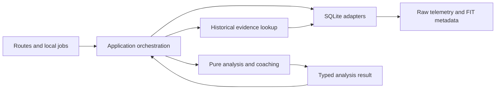

# Codebase structure audit — October 3, 2026

## Recommendation

The main analysis-ownership and coaching-protocol refactor is implemented. The recording-density correction, economy input typing and lightweight dependency-boundary checks are now implemented. Keep the existing local application, React frontend, Express backend, worker threads, and single SQLite database.

Import and replay now share workout analysis, edits share history invalidation, and coaching uses structured identifiers. Further module extraction should follow concrete ownership needs; the illustrative folder layout below is not a requirement to move every file.

The original audit reviewed the working tree, including pending background-import work, rather than only committed HEAD. The evidence and line references below describe that initial inspection. The status notes record subsequent implementation checkpoints, including this follow-up; verification is recorded separately below.

## Completion status

Rechecked October 3 against `919932a` and the current source. This includes the tempo/classification checkpoint `eaa4587`, storage/snapshot checkpoint `996a020`, and audit follow-up `919932a`. Concurrent source edits and generated `data/` / `output/` artifacts are outside this documentation update. Earlier verification counts are historical results, not checks rerun for this document-only review.

| Finding | Implemented work | Remaining work | Status |
| --- | --- | --- | --- |
| 1. Analysis context | Shared pipeline plus timer/gap-aware load, calibration, coaching, query fallbacks, shared speed repair and historical detail-chart thresholds | Independent physiological validation remains unperformed | Timer and recording-density policies addressed |
| 2. History invalidation | Existing transactional history coordinator plus transactional weather invalidation of edited/later coaching | None in the documented change matrix; automatic weather fetching is outside scope | Addressed |
| 3. Coaching protocol | IDs and nested parameters for headlines, advice, insights, descriptions and focus; dictionary-owned Chinese templates; legacy text fallback | No open implementation item | Addressed |
| 4. Typed boundaries | Canonical row adapters and segment persistence, shared DTOs, validated JSON, classifier evidence; explicitly typed coaching compatibility adapters and canonical calculations | None in the documented implementation scope | Addressed, including economy inputs and dependency guards |
| 5. Migration ownership | Ordered schema/derived registries, grouped equivalent algorithm upgrades, persisted revision and historical-profile/telemetry provenance | Distinct historical data migrations intentionally retain their separate checkpoints | Addressed |
| 6. Writer coordination | Shared operation ownership for workers, storage, weather and analysis; service guards; worker reservations held through exit; stored detail summaries with explicit freshness | Coordinator is process-local, consistent with the application's single-server architecture | Addressed |
| 7. Frontend/CSS structure | Browse selection/detail, import, stats and period-progress controllers; feature types/selectors; common invalidation; ordered CSS split; reviewed baselines and current mobile range controls | No open frontend implementation item identified in this recheck | Addressed |

The previous implementation checklist is complete, but that does not close every acceptance criterion in the broader roadmap. The latest follow-up and remaining external validation are listed below. Original evidence and line references later in this document describe the pre-refactor code and must not be read as present-day defects.

## Latest follow-up implementation

### P2 — Weight coaching intensity by observed duration

At the source recheck, `src/backend/physiology/coaching/evidence.ts:487` required 30 samples. Its binning at `:513` increments early/late counters once per sample, and `:528` returns their sum as `sampledSec`. Timer and gap boundaries are respected, but recording density still controls coverage and the percentages presented as running time.

A read-only `tsx` check using the same two-minute constant-HR run produced `sampledSec: 120` with one-second records and `null` with five-second records. This demonstrates a coverage difference; unequal-density percentage distortion follows from the counters, but was not separately measured in this review.

- [x] Use active observed interval durations for coverage, band percentages and temporal halves; make smoothing time-aware while preserving timer/gap fences.
- [x] Add equivalent one-second, five-second and irregular-recording fixtures, including stopped segments and gaps. Verify meaningful durations and comparable results rather than identical sample counts.

This is a numerical correction and should be reviewed separately from module moves. The persisted revision is now `coaching-duration-v1`; the matching migration joins the existing atomic grouped refresh. A reopen regression verifies persisted revision and one-time refresh.

### P2 — Finish economy input typing

At the source recheck, `src/backend/physiology/economy.ts:55` normalized `any[]`, and `:131` exposed `extractSteadyStateMetrics(records: any[])`. It also imported `ActivityRecord` through the CSV parser compatibility export at `:1`, although the canonical type now lives in `domain/telemetry.ts`. These were the remaining entry points at the source recheck; the follow-up now uses `EconomyRecordInput` and the canonical domain import, and validates migration rows through the existing row adapter.

- [x] Define explicit legacy-compatible economy input types, normalize them at the entry point, and import the canonical domain telemetry type directly.
- [x] Preserve missing-sensor, snake_case compatibility, timer/gap and numerical behavior with the existing economy/split fixtures.

Legacy field spellings are supported compatibility, not a reason to rename the public API.

### P3 — Enforce the established dependency boundaries

The original roadmap requested lightweight import-boundary checks. The source recheck found no architecture import guard. The follow-up adds `architecture/dependency-boundaries` to the existing lint workflow, with regression tests for imports, re-exports, dynamic imports and type-only imports.

- [x] Add checks preventing domain-to-SQLite/HTTP/jobs imports, shared-to-application imports, and feature-child imports of page/controller modules for common types.
- [x] Include type-only imports in the policy explicitly and enforce the checks in the existing verification workflow.

### Optional structural cleanup

`physiology/threshold-tracker.ts` still combines evidence evaluation, SQLite reads/writes, historical selection, rolling estimates and profile-cache updates (`evaluateThresholdUpdate` at `:281`, `computeRollingThresholds` at `:717`). `physiology/training-load.ts` combines pure activity-load calculation with the database-backed `calculateTrainingStatus` query at `:150`. These are remaining seams from the proposed boundaries, not demonstrated calculation defects. Extract them only when their callers or future changes justify the additional modules.

## Remaining validation

- [x] Rebuild desktop/backend and snapshot targets and run packaged smoke checks against the latest code before release; earlier packaged results below predate the final coaching and snapshot-loading changes.
- [x] Exercise the exported snapshot browser workflow for the latest combined checkpoint; the 19-test app visual suite does not include the separate `tests/visual-snapshot` project.
- [ ] Obtain independent physiological validation of timer/gap and scoring policies if making physiological-accuracy claims.

Performance benchmarking and coverage measurement were not rerun in this source recheck. They are validation opportunities, not evidence of a performance or coverage regression.

## What already works structurally

- Frontend, backend, and shared code have separate roots. A scan of resolved relative imports found no backend-to-frontend or shared-to-application imports.
- Routes for activities and profiles delegate to services; row conversion exists in `backend/db/rows.ts`; a frontend API client centralizes transport and errors.
- Named migration checkpoints, transaction support, safety snapshots, storage operations, and background maintenance are already present. Build on them.
- Historical fitness lookup explicitly excludes current/future evidence. Automatic labels and athlete confirmations are stored separately. Preserve both contracts.
- The regression suite includes confirmed historical runs, recording-density cases, FIT import/replay, historical fitness, database restore, UI flows, and snapshot behavior. These are valuable migration protection.
- The classifier itself is approximately 290 lines. Its length is not the main problem: the surrounding pipeline has several owners, while downstream scoring and persistence accept overlapping representations.

## Prioritized findings

### 1. P1 — Analysis context is assembled independently and reaches only some consumers

**Status:** shared preparation now reaches load, calibration, coaching and query fallbacks; speed repair and historical detail thresholds share named policies. Recording-density handling in coaching intensity is addressed by the duration follow-up above.

**Evidence:** `ingestion/importer.ts:130` prepares FIT-aware analysis, then calculates economy, splits, intervals, and classification from the annotated records. `db/realign.ts:149` assembles essentially the same pipeline. Import-time training load (`importer.ts:256`) and calibration (`importer.ts:409`) receive raw records. Replay passes annotated records to those functions. `physiology/coach-summary.ts:611` loads raw SQLite telemetry and extracts steady-state metrics without rebuilding FIT timer state. `physiology/profile-recompute.ts` also loads only time/HR columns.

Crucially, `physiology/training-load.ts:64` accepts raw/camelCase field variants and checks recording gaps, but does not check timer activity or timer segments. Passing annotated records alone will therefore not make load timer-aware. `physiology/time-series.ts` already provides timer-aware observed intervals, but this consumer does not use them.

The detail query has another context split: `services/activity-service.ts:416` repairs a response copy of speed telemetry and calculates pause/steady-state values from it, while coaching reloads the original rows. The same response obtains `heartRateThresholds` from the current profile, while its coach summary uses date-specific thresholds. Historical chart bands and coaching can therefore refer to different fitness states. Move repair and historical context selection into named shared policies; distinguish current-profile displays from workout-date displays.

**Impact:** classification, calibration, load, and coaching can interpret the same recording differently. This is a demonstrated input/policy inconsistency, not a claim that every current metric is wrong. `docs/fit-classification.md` explicitly records the incomplete propagation. The existing FIT replay test checks labels, pause totals, intervals, and raw retention; it does not establish load/calibration/coaching equivalence.

**Refactor:** introduce `AnalysisContext` containing normalized analysis records, FIT structure, historical HR profile, stride anchor, and evidence provenance. Retain raw records separately for export. Share preparation and calculation through `analyzeWorkout(context, confirmations)`. Make every consumer's timer, gap, missing-sensor, and fallback policy explicit. Standardize the evidence semantics before reusing calculated results.

Extract shared orchestration first without changing numerical behavior; apply timer-policy corrections as separate reviewed changes with their own expected-output updates.

### 2. P1 — Derived-data invalidation depends on which operation changed the workout

**Status:** the main checkpoint and weather coaching invalidation are implemented. The differences in the original evidence below are resolved for the coordinated operations. See `HISTORY_INVALIDATION.md`.

**Evidence:** corrected/backfilled import finds affected later activities and replays them atomically (`ingestion/importer.ts:412`, `:456`). `services/activity-service.ts:601` handles manual type/failure updates by changing the activity and synchronizing that activity's coach summary (`:658`); it does not rebuild calibration, tags, race segmentation, or dependent later workouts. `computeRollingThresholds` excludes manually failed sources on reads, but does not reject sources merely because their label changed. `services/profile-service.ts:189` determines baseline changes and triggers `recomputeProfileDerivedData`, which refreshes load/zones and coaching, without rebuilding classification or calibration.

**Impact:** an import correction and a UI correction have different consequences for stored analysis. Marking a workout failed can immediately change threshold reads while leaving later stored labels/zones based on the previous evidence. A label edit can leave an old workout-derived observation eligible until replay. Baseline profile edits also have a narrower refresh scope than a full realignment. Whether each edit should rewrite history needs one documented policy.

**Refactor:** make an application-level history coordinator own affected-range selection, chronological processing, confirmation precedence, calibration replacement, current-profile cache updates, and transaction boundaries. Define a change matrix for raw-data correction, date correction, confirmed type, confirmed failure, baseline demographics/HR, and weather. Cosmetic title edits should not trigger a physiological replay. Weather should invalidate the relevant coaching result; history-sensitive consumers may require later summaries too.

Preserve the current atomic affected-history import contract. Do not accidentally replace it with independently committed per-activity jobs. Distinguish strict transactional correction from best-effort maintenance, which currently isolates corrupt activities and reports failures.

### 3. P1 — English presentation text serves as a domain protocol

**Status:** new prose uses stable message IDs and nested parameters; Chinese copy is dictionary-owned, including the fallback adapter. See `COACHING_PROTOCOL.md`.

**Evidence:** `physiology/session-verdict.ts:6` maps English factor labels to verdicts and selects factors by English category strings. `physiology/coach-rubric.ts` emits those strings. `frontend/i18n/coachTranslator.ts` is approximately 784 lines of mapping, substring matching, and regular expressions over English headlines, advice, and insights. It also embeds Chinese copy outside the three prescribed dictionary files.

**Impact:** renaming a factor's English label can change a verdict to `insufficient_evidence`, even if the numerical result is unchanged. Backend wording changes can silently fall through to untranslated English. The backend rubric, verdict logic, translation parser, and UI contract consequently need coordinated edits for what should be a wording change.

**Refactor:** emit typed factor/category IDs, finding IDs, message IDs, parameters, and tones. Compute verdicts from IDs. Keep backend English text as the source of truth, consistent with project rules; dictionary-owned Chinese overrides/templates should use stable IDs rather than parse English sentences. Preserve English fallback and a legacy adapter for stored summaries and old snapshots. Put all new UI copy in `types.ts`, `en.ts`, and `zh.ts`.

Use plain unions and explicit functions; a configurable rules framework is unnecessary.

### 4. P2 — Typed boundaries still permit multiple competing representations

**Status:** canonical telemetry rows, shared segment persistence, concrete DTOs, persisted classifier evidence and explicitly typed coaching adapters are implemented. Economy compatibility inputs and automated import guards are also implemented by the latest follow-up.

**Evidence:** normalized `ActivityRecord` belongs to `ingestion/csv-parser.ts`, although FIT analysis and physiology consume it. `db/realign.ts:32` has an independent `any[]` record mapper and an `any` database argument. Rubric helpers (`coach-rubric.ts:187`) accept both snake_case and camelCase through `any`. Backend shared detail contracts (`shared/activity-detail.ts`) expose open index signatures and `unknown` scoring fields, while `frontend/types/api.ts` separately defines more specific splits, intervals, records, coach summaries, and detail responses.

**Impact:** TypeScript can pass while a domain field is omitted from a mapper or backend/frontend contracts diverge. Runtime row validation is valuable, but an open `unknown` structure does not establish the calculation contract. New FIT fields currently require auditing several conversion paths.

**Refactor:** define parser-independent domain telemetry, interval, split, and result types. Convert SQLite rows once in typed adapters. Keep snake_case in persistence and existing wire formats initially; use one normalized representation in calculations. Put actual shared API DTOs in `shared/contracts`, including structured coaching evidence, and re-export them from the existing frontend type module during migration. Do not require a wholesale API rename.

The classifier should return an explicit evidence record: rule ID, observed measurements, applicable profile/policy values, and confidence. Its existing fixed confidence values must not be represented as statistically calibrated probabilities.

### 5. P2 — Database opening still owns a growing list of algorithm upgrades

**Status:** schema and derived upgrades use ordered registries; equivalent pending current-algorithm upgrades share one refresh. Summary JSON carries revision and historical-input provenance.

**Evidence:** `db/client.ts` is approximately 412 lines and contains schema setup plus many derived-data migration bodies. At `:312` onward, checkpoints such as `realign-v1`, `signal-classification-v1`, `historical-fitness-v1`, and `fit-structure-v1` invoke current realignment code. The existing runner is checkpointed and recoverable; the concern is ownership and repeated work, not absence of migrations.

**Impact:** an older database may run several full-history passes using the same current algorithm. A classifier adjustment requires touching connection initialization. Schema compatibility and analysis freshness are intertwined, and a historical migration name does not identify which current analysis implementation actually produced the stored result.

**Refactor:** move existing migrations into an ordered registry without changing their IDs or checkpoints. Separate essential schema migrations from derived-analysis upgrade scheduling. Introduce persisted analysis revision/provenance only once its refresh policy is defined. Plan one latest-compatible refresh for pending analysis upgrades where safe; preserve genuinely distinct data migrations and their snapshots. Keep existing databases and read-only snapshots compatible.

### 6. P2 — Coordination of writers is distributed across services and middleware

**Status:** one process-local reservation/ownership coordinator now guards workers, storage, weather and analysis writes through service entry points. Detail reads return stored summaries and freshness.

**Evidence:** pending `jobs/import-job.ts` checks maintenance before reserving an import. `jobs/maintenance.ts` owns a separate worker and queued profile recomputation. `db/storage.ts` has its own operation guard and maintenance checks. `server.ts:104` blocks mutations during import. Activity GET handlers suppress coach-summary persistence during import; outside that path, `getActivityDetailService` regenerates and persists coaching on detail reads (`activity-service.ts:475`).

**Impact:** the current protection is spread across several entry points. Adding a new job or a service caller requires knowing which guard applies. GET requests also participate in writing and recalculation. This is an ownership concern; the audit did not demonstrate a live concurrent-writer failure or measure request latency.

**Refactor:** introduce one local operation coordinator covering import, maintenance, restore, relocation, and analysis writes. Make services participate directly so correctness does not depend only on HTTP middleware. Retain bounded parallel decoding and serialized SQLite writes. Gradually make detail reads return stored analysis with explicit freshness; use coordinated rebuilding for missing/stale results. Avoid a cloud queue or distributed event bus.

### 7. P2 — Feature controllers and global styling are the frontend growth points

**Status:** feature controllers, shared invalidation and the stylesheet split are implemented. Reviewed visual baselines and current mobile interaction selectors complete visual acceptance.

**Evidence:** `BrowseView.tsx` is approximately 693 lines; `StatsView.tsx` 670; `PeriodProgressView.tsx` 768; `UploadModal.tsx` 498. They mix fetching, cancellation/retry, selection/filtering, chart derivation, mutations, and rendering. `App.tsx` owns activity lists, refresh callbacks and a detail refresh counter, while other views fetch their own data. `frontend/styles/index.css` is approximately 6,260 lines with shared primitives, feature rules, responsive overrides, and development diagnostics together.

Some extracted browse children import types back from their parent view. The resolved import graph finds type dependency cycles around browse and around rubric/verdict types; this is not evidence of a runtime cycle, because TypeScript can erase type-only usage.

**Impact:** component extraction alone has left control logic in page files. Refresh rules remain spread across callbacks and effects. Global selectors and source-order overrides make moving markup harder to review. File length is a prioritization signal, not proof of a defect or measured performance cost.

**Refactor:** organize frontend modules by feature and extract controllers/hooks for activity detail, browse selection, import progress, and stats loading. Put reusable display selectors and feature types outside page components. Define one revision/invalidation signal for successful imports, activity edits, restore, and maintenance completion, consumed by the affected views. A small existing-stack solution is enough initially; a new state-management dependency needs a concrete benefit.

Split CSS into tokens, shared primitives/layout, and feature files while initially preserving selector names and import order. Use visual regression tests before changing specificity or deleting apparent duplicates. Keep release exclusion of development tools intact.

## Proposed boundaries

Names below are illustrative destinations, not an instruction to move all files at once:

```text
src/backend/
  domain/
    telemetry/       normalized records, timer/gap evidence, movement
    workouts/        segmentation, classification, confirmation policy
    thresholds/      pure LT1/LT2 evidence and rolling calculations
    coaching/        audits, family scoring, verdicts, structured findings
  application/
    analysis/        analyze-workout, replay-history, affected-range policy
    imports/         duplicate policy, batch orchestration
    queries/         activity detail, volume, progress, training status
  db/
    adapters/        typed reads and result persistence
    migrations/      existing schema/data migration registry
    client.ts        select/open/configure connection
    storage.ts       file snapshots, restore, relocation
  jobs/              local scheduling, workers, progress/recovery
  routes/            request validation and response mapping

src/shared/contracts/  actual API DTOs and stable evidence/message IDs
src/frontend/
  features/{browse,progress,stats,profile,imports,settings}/
  components/        reusable UI primitives
  api/               desktop and snapshot transport implementations
  i18n/              dictionary-owned copy and structured-message formatting
  styles/            tokens, primitives, layout, feature styles
```



Application orchestration owns transactions and chronological replay. Domain calculations receive typed values and do not open the database, query SQLite, or schedule workers. Routes consume application operations. API contracts preserve existing clients while internal representations improve.

Segmentation should distinguish telemetry detection, FIT-lap refinement, race segmentation, and summary construction. Coaching should distinguish pacing/intensity/walk evidence, aerobic/quality/race scoring, verdict selection, and message rendering. Threshold code should separate evidence calculation, observation persistence, historical selection, rolling smoothing, and current-profile cache updates. These seams have concrete consumers; arbitrary file-size limits would be less useful.

## Migration sequence and acceptance criteria

Progress against this roadmap: fixture coverage and the shared pipeline are implemented; typed adapters and segment persistence are consolidated; weather participates in transactional history invalidation; coaching prose and DTO migration are implemented; migrations and writer ownership are centralized; frontend controllers and ordered CSS modules are extracted and visually verified. The sequence below records the original acceptance criteria.

1. **Establish behavioral contracts.** Extend fixture checks across single import, batch import, chronological replay, manual correction, and profile refresh. Check stored load/zones, calibration eligibility, coaching evidence, confirmation retention, and raw-record retention. Record existing intentional differences before correcting them.
2. **Normalize inputs and extract the shared analysis pipeline.** Keep existing importer/realigner exports as compatibility wrappers. Consolidate mapping and interval/split persistence. Separate extraction from algorithm changes. Require unchanged expected outputs for the extraction commit.
3. **Centralize history invalidation.** Implement the change matrix and strict/best-effort policies. Test backfills, moved dates, manual failure/type edits, changed baseline HR, failed dependent replay, and repeated replay. Strict corrections must roll back as a whole on dependent failure.
4. **Introduce stable coaching evidence and shared contracts.** Move verdicts to IDs, then replace prose parsing incrementally. Test that English wording changes leave verdicts unchanged and that both languages and legacy snapshots remain readable. Split rubric scoring by existing run family.
5. **Separate migrations and local operation coordination.** Preserve migration checkpoints. Test legacy reopen, failed migration/retry, interrupted jobs, restore/relocation while jobs are active, and detail reads during analysis. Inspect packaged worker paths and snapshot export, not just source imports.
6. **Restructure frontend features and CSS.** Extract feature state/controllers, then move files and styles. Preserve localization and refresh behavior. Run relevant desktop/mobile/tablet visual tests and packaged/snapshot checks for affected boundaries.

Each step should be independently reviewable. Retain the original public entry points until their callers are migrated. Use disposable database fixtures and backups for parity/replay comparisons; do not experiment on the selected workout database. Existing snapshot and installer behavior are compatibility constraints.

Add lightweight import-boundary checks once the destinations are established: domain modules must not import SQLite, HTTP, or job scheduling; shared contracts must not import application code; feature children should not import page/controller modules for common types. A repository-wide abstraction framework is unnecessary.

## Verification and limitations

On the working tree available during the original audit:

- `npx tsc --noEmit`: passed.
- `npm run lint`: passed with the configured zero-warning gate.
- `npm test`: 98 files, 1,070 tests passed.
- `npm run i18n:unused`: all 776 dictionary keys referenced.

The original audit was a source-structure and dependency review, supported by the existing test baseline. It did not run coverage, visual tests, packaged smoke tests, production benchmarks, or independent physiological validation.

Subsequent implementation checkpoints added focused pipeline-parity, history-invalidation, wording-independent verdict, bilingual rendering, and persisted-message tests. At `9dd8d21`, the full working tree passed TypeScript, zero-warning lint, all 1,131 tests, and the unused-key check for all 810 dictionary keys. An isolated export of that checkpoint also compiled, passed 108 focused tests, built the application and snapshot viewer, and passed the packaged backend smoke test. The build emitted existing CommonJS `import.meta` warnings in the maintenance bundle. No visual suite, coverage run, performance benchmark, or independent physiological validation was added by these checkpoints.

Do not combine classifier tuning, numerical corrections, schema changes, file moves, and UI redesign into one refactor. Preserve the working foundations, consolidate analysis ownership first, and then reorganize files around those responsibilities.

## Implemented checkpoints

The shared typed workout-analysis pipeline is implemented in `application/analysis/analyze-workout.ts` and used by import and replay. Subsequent checkpoints address prioritized findings 2 and 3:

- History invalidation now has one transactional coordinator. Import corrections, manual physiological confirmations, and baseline-profile recomputation use it. See `HISTORY_INVALIDATION.md` for the change matrix and remaining independent policies.
- Rubric factors and verdicts use stable identifiers. Headlines and recommendations use structured messages with bilingual dictionary overrides, while legacy payloads remain supported. See `COACHING_PROTOCOL.md` for the compatibility boundary and structured prose protocol.

These checkpoints establish ownership boundaries without changing classifier thresholds or numerical scoring. The broader migration sequence above remains a roadmap; it is not a claim that every suggested subsystem split is complete.

## Follow-up implementation verification

The follow-up adds regression checks for stopped FIT heart rate in load/coaching, timer boundaries in continuous calibration, import-summary rollback, weather/dependent-summary rollback, grouped migration retries, writer ownership, stored-summary freshness/provenance, stored coaching JSON validation and common frontend revision subscriptions. Raw records and FIT bytes remain unchanged.

Desktop and snapshot-template builds and the packaged backend smoke test pass. The build still emits the existing CommonJS `import.meta` warnings. TypeScript, zero-warning lint, all 1,146 tests across 109 files, and all 810 dictionary-key references pass. A subsequent DTO validation tightening is covered by focused contract, coaching, API and snapshot regression checks.

At the earlier CSS-extraction checkpoint, the visual suite reported 6 passes and 13 failures both before and after the split. An isolated HEAD checkout reproduced the desktop Browse baseline mismatch and the mobile accessibility test's missing button selector. Eleven of twelve comparable pre/post-split screenshots were pixel-identical; the remaining chart canvas differed by about 0.25% of pixels, below its 1% comparison tolerance. CSS extraction preserved every rule and source order. Snapshots were not rewritten at that checkpoint. This verified the stylesheet extraction narrowly; the later baseline repair is recorded below.

The follow-up refreshed the reviewed component baselines after the layout changes and replaced the obsolete SVG-button assertions with the current period and threshold range controls. The complete visual suite now passes 19 tests across desktop, mobile and tablet projects. The full repository suite passes 1,174 tests across 113 files; TypeScript, zero-warning lint, and the unused-key check for all 816 dictionary keys also pass.

No selected workout database was migrated or edited during this work; database verification used disposable fixtures. No performance benchmark or independent physiological validation was performed.

This documentation recheck inspected the current source, migration revision, compatibility adapters, lint policy and test inventory, and reproduced the coaching recording-density coverage difference with an in-memory input. `git diff --check` passed. No application source was changed and the full test/build suites were not rerun for this documentation-only update.

## Duration and dependency follow-up verification — October 3, 2026

Coaching intensity now integrates adjacent active running intervals and smooths piecewise-linear HR using time-weighted integrals within contiguous evidence blocks. Coverage requires 30 observed seconds rather than 30 records. Band classification uses one-second midpoint quadrature with fractional endpoints retained; halves split observed running HR duration. Stops, walking, missing/nonfinite HR, timer changes and recording gaps fence both coverage and smoothing. One-second, five-second and irregular fixtures agree for a linear-HR trace and separated constant-HR blocks. This verifies recording-density behavior, not independent physiological accuracy.

Economy accepts explicitly typed camelCase and legacy snake_case sensor inputs; absent sensor values retain their prior behavior. Domain and shared import boundaries and feature-child dependencies are enforced by ESLint, including type-only dependencies.

TypeScript and zero-warning lint pass, and all 816 dictionary keys are referenced. The full suite passed 1,201 tests across 115 files; the subsequently added migration-reopen regression passed in the 13-test focused migration suite. Desktop/backend, snapshot-template and exported snapshot builds pass. Packaged backend smoke passes, and both snapshot-browser tests pass, including first-load offline caching and mobile read-only navigation. Builds retain the pre-existing CommonJS `import.meta` warnings. Snapshot verification used the existing exported snapshot; no selected workout database was changed. Concurrent snapshot/chart edits in the working tree are included in these combined verification results, but are outside this follow-up's implementation scope.

Optional module extraction and independent physiological validation remain as documented above. No performance benchmark or coverage measurement was added.
